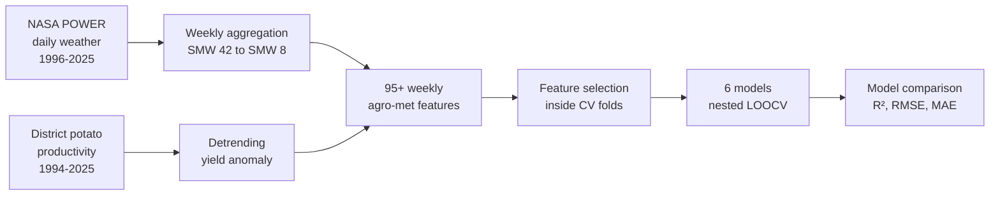

<div align="center">

# 🥔 Potato Yield Forecasting from Weather Data
### An AI/ML framework for Mehsana, Gujarat

*Can the weather during the growing season explain why potato yields swing from year to year?*
*This project answers that with 29 years of data, 95+ engineered weekly features, and 6 rigorously cross-validated models.*


</div>

---

## 📌 At a Glance

| | |
|---|---|
| **Problem** | Explain and predict interannual potato yield variation using weather |
| **Study area** | Mehsana district, Gujarat, India |
| **Data** | 29 years of NASA POWER weather (1996–2025) + district-level potato productivity statistics |
| **Modelled seasons** | 28 (1997–98 to 2024–25) |
| **Features** | 95+ weekly agro-meteorological features, plus a lag-1 yield anomaly |
| **Models benchmarked** | MLR, XGBoost, KNN, SVR, Random Forest, ANN (MLP) |
| **Validation** | Nested Leave-One-Out Cross-Validation (LOOCV), with feature selection inside each fold |
| **Best model** | Multiple Linear Regression + SelectKBest: **R² = 0.59, RMSE = 1.231, MAE = 0.948** |

---

## 🎯 Why This Project Matters

Potato is a high-value crop in North Gujarat, and its yield varies noticeably from season to season. Weather is one of the main drivers, but its effect is **not uniform across the season**. A cold night in one week can matter far more than the same temperature a month later.

Understanding *which weeks and which variables* matter can support crop monitoring, early-season risk assessment, and agricultural planning. This project builds a **week-resolved, leakage-aware** modelling pipeline to find out.

---

## 🧭 Approach



1. **Season definition.** The potato growing season runs from Standard Meteorological Week (SMW) 42 to SMW 8, crossing the calendar-year boundary. It is handled explicitly so that weeks 42–52 and 1–8 are linked to the correct season.
2. **Weekly feature engineering.** Daily weather is aggregated into week-specific predictors: maximum temperature (MAXT), minimum temperature (MINT), mean relative humidity (RH), wind speed (WS) and bright sunshine (BSS). This produces **95+ candidate features**.
3. **Detrending.** Long-term yield improvements (better varieties, management) are separated from year-to-year anomalies, so the models explain *weather-driven variation* rather than just the upward trend.
4. **Lag-1 yield anomaly.** The previous season's anomaly is added as a predictor to capture carry-over effects.
5. **Feature selection without leakage.** With ~28 samples and 95+ features, overfitting is the main risk. Feature selection (SelectKBest F-test or Forward Selection) is performed **inside each validation fold**, never on the full dataset.
6. **Model benchmarking.** Six model families are compared under identical nested LOOCV, evaluated on R², RMSE and MAE.

---

## 📊 Results

### Model comparison (detrended yield-anomaly target)

| Rank | Model | Feature selection | # Features | R² | RMSE | MAE |
|:---:|---|---|:---:|:---:|:---:|:---:|
| 🥇 | **Multiple Linear Regression (MLR)** | SelectKBest (F-test) | 5 | **0.59** | **1.231** | **0.948** |
| 2 | XGBoost | Forward Selection | 5 | 0.45 | 1.424 | 1.165 |
| 3 | K-Nearest Neighbours (KNN) | Forward Selection | 6 | 0.45 | 1.434 | 1.265 |
| 4 | Support Vector Regression (SVR) | Forward Selection | 5 | 0.41 | 1.483 | 1.258 |
| 5 | Random Forest | SelectKBest (F-test) | 5 | 0.39 | 1.506 | 1.120 |
| 6 | ANN (MLP) | SelectKBest (F-test) | 7 | 0.34 | 1.567 | 1.252 |

### Key findings

- **A simple, interpretable model won.** With only 28 seasons, MLR outperformed every non-linear model, including XGBoost, Random Forest and a neural network. On small agronomic datasets, model complexity does not automatically buy accuracy.
- **Few weeks carry most of the signal.** The best model uses just 5 predictors: **wind speed in SMW 49, 52 and 1**, **minimum temperature in SMW 43**, and the **lag-1 yield anomaly**.
- **Timing matters.** The selected features come from specific weeks of the season rather than seasonal averages, which supports building week-resolved features in the first place.
- **No single metric tells the whole story.** Random Forest has a lower MAE than XGBoost, KNN and SVR despite a lower R², which is why all three metrics are reported.

### Held-out accuracy on the original yield scale

Converting LOOCV predictions back to actual yield (MT/ha) for all 28 seasons:

| Metric | Value |
|---|---:|
| RMSE | **1.230 MT/ha** |
| MAE | **0.948 MT/ha** |
| Mean observed yield | 23.378 MT/ha |
| Observed yield range | 16.46 – 29.98 MT/ha |

So the typical prediction error is roughly **4–5% of the mean yield**.

> **Note on interpreting R².** The R² values in the comparison table are for the *detrended anomaly*, a deliberately harder target. An R² computed on raw yield looks much higher (≈ 0.93 for LOOCV) because the long-term trend is easy to predict. The two are not comparable, so the anomaly-based figures are the honest measure of weather-driven skill.

---

## 🗂️ Repository Structure

```
gujarat-potato-yield-weather-ml/
├── Code_Script/                           # Modelling code and analysis
├── Data/                                  # Weather and potato productivity inputs
├── Outputs/                               # Model results, predictions and figures
├── AI,ML_based_potato_yield_modelling.pptx  # Project presentation
└── README.md
```

📑 A summary presentation of the project is included: [`AI,ML_based_potato_yield_modelling.pptx`](./AI%2CML_based_potato_yield_modelling.pptx)

---

## 🚀 Getting Started

```bash
# 1. Clone the repository
git clone https://github.com/dhruv-soni-agritech/gujarat-potato-yield-weather-ml.git
cd gujarat-potato-yield-weather-ml

# 2. (Recommended) create a virtual environment
python -m venv venv
source venv/bin/activate        # Windows: venv\Scripts\activate

# 3. Install dependencies
pip install pandas numpy scikit-learn xgboost matplotlib seaborn openpyxl jupyter

# 4. Run the analysis from the Code_Script/ folder
```

Input datasets are in `Data/`, and generated results are written to `Outputs/`.

---

## 🛠️ Tech Stack

| Area | Tools |
|---|---|
| Language | Python |
| Data handling | Pandas, NumPy |
| Modelling | Scikit-learn (MLR, KNN, SVR, Random Forest, MLP), XGBoost |
| Validation | Nested Leave-One-Out CV, SelectKBest (F-test), Forward Selection |
| Visualisation | Matplotlib, Seaborn |
| Data source | NASA POWER (weather) |

---

## ⚠️ Limitations (and What I'd Do Next)

Being clear about what the results do and don't show matters as much as the results themselves.

- **Small sample.** 28 seasons limits how confidently results generalise. LOOCV is the right tool here, but estimates remain uncertain.
- **Correlation, not causation.** Selected features show predictive usefulness in this dataset, not proof of a biological mechanism.
- **Missing management factors.** Cultivar, irrigation, planting date and pest and disease pressure are not explicitly modelled.
- **Single district.** The model is specific to Mehsana and has not been tested on other regions.

**Future work**
- Validate on newly observed seasons before any operational use
- Extend to other potato-growing districts of Gujarat
- Add remote-sensing indices such as NDVI/EVI as additional predictors
- Quantify prediction uncertainty with confidence intervals
- Wrap the model in a lightweight dashboard for seasonal forecasts
